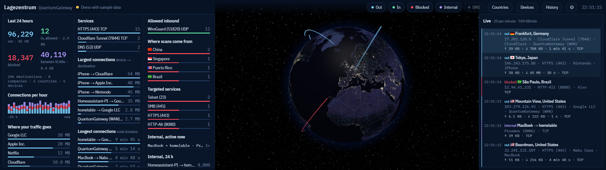

# Lagezentrum on the CORSAIR XENEON EDGE



**Download:** `lagezentrum.icuewidget` from the [latest release](https://github.com/GUNSTAR1/unifi-HQ/releases/latest).

Requirements:

- Windows with iCUE 5.46 or newer.
- A Corsair Xeneon Edge.
- A Lagezentrum server collecting your UniFi gateway's logs (setup is in the [main README](../README.md)). Without
  one, the widget shows demo data.

Lagezentrum's dashboard, laid out for the Xeneon Edge's 2560×720 touch strip:

- **Globe or flat map** in the middle.
- **24 h stats** on the left, in columns.
- **Live ticker** on the right.

Portrait mounting (720×2560) stacks them: globe on top, stats in the middle, ticker at the bottom.

You can run it two ways. Both need the Lagezentrum server (LXC/Docker) from the main README.

## A. iCUE widget (recommended)

1. **On the server**, if the dashboard has a login password, create a widget key:

   ```bash
   cd /opt/lagezentrum && ./lagezentrum.sh widget-key
   ```

   It prints the server address and the key. The key gives the widget read-only access in place of the login cookie. `widget-key new` rotates it and `widget-key off` disables it.
2. **On the PC**, double-click `lagezentrum.icuewidget`, or use iCUE → XENEON EDGE → **Widgets** → **+**. Give it the **full-width slot**. Smaller slots hide the ticker first, then the stats.
3. **In the widget settings:**
   - **Server Address:** for example `192.168.1.50`. Port 8080 is added if you leave it off.
   - **Widget Key:** paste the key from step 1.
   - With no address, the widget shows demo data.

Other settings: map (globe/flat), color scheme, auto-rotate, which panels to show, and **Lite Mode** (less GPU load). The ⚙ menu on the screen itself still works too.

Device names are read-only in the widget. Rename devices in the dashboard in a normal browser.

**Tailscale:** Caddy only answers LAN addresses by default. If the PC reaches the server over Tailscale, add `100.64.0.0/10` to `ALLOWED_CLIENTS` in `.env`, then run `docker compose up -d`.

## B. Plain browser on the Edge (as a Windows display)

Open `http://<server>:8080/?edge` in a full-screen or kiosk browser window on the Edge. For example:

```
msedge --kiosk "http://192.168.1.50:8080/?edge" --edge-kiosk-type=fullscreen --window-position=<x>,<y>
```

Any window wider or taller than 3:1 switches to the Edge layout automatically. `?edge=0` turns that off. You log in once as usual.

Text is sized from the strip's short side, so it stays the same physical size at any Windows scaling (100 % = 720 px → 1.25× zoom). The ⚙ → **Font size** setting scales on top of that.

## Rebuilding the widget

After changing anything in `web/`:

```powershell
.\edge-widget\build.ps1
```

This copies `web/` into `edge-widget/Lagezentrum/`, adds the iCUE head from `src/head.html` and the loader `src/boot.js`, and packages `lagezentrum.icuewidget` with Corsair's `icuewidget` CLI. `-NoPackage` skips the packaging step. Open `Lagezentrum/index.html?server=<ip>&key=<key>` in a browser to test without iCUE.

## Switching an existing server to this fork

If your dashboard has a login password, the widget needs the widget key, which only exists in this fork.
Your settings (`.env`, device names, history) are kept.

**LXC made with `create-lxc.sh`.** On the Proxmox host:

```bash
cd /root/unifi-HQ
git remote set-url origin https://github.com/GUNSTAR1/unifi-HQ.git
git pull
./proxmox/update-lxc.sh
```

Then, inside the container: `cd /opt/lagezentrum && ./lagezentrum.sh widget-key`.

**Cloned straight into `/opt/lagezentrum`.** Inside the container:

```bash
cd /opt/lagezentrum
git remote set-url origin https://github.com/GUNSTAR1/unifi-HQ.git
git pull
docker compose up -d --build
./lagezentrum.sh widget-key
```

**New install:** set `REPO_URL=https://github.com/GUNSTAR1/unifi-HQ.git` for `create-lxc.sh`, or clone this repo in
place of the original.

## Server changes in this fork

- `api/auth.go`: accepts `WIDGET_KEY` as `Authorization: Bearer …`. For `/ws`, it also accepts `?key=…`, because browsers can't set headers on a WebSocket. Keys shorter than 24 characters are ignored.
- `caddy/Caddyfile`: answers CORS preflights and adds `Access-Control-Allow-Origin: *` to requests that carry a bearer key. It also strips `key` before passing `/ws` to Vector. With `*`, browsers never send the login cookie, so without the key everything stays 401.
- `lagezentrum.sh widget-key`, plus `WIDGET_KEY` in `docker-compose.yml` and `.env.example`.
